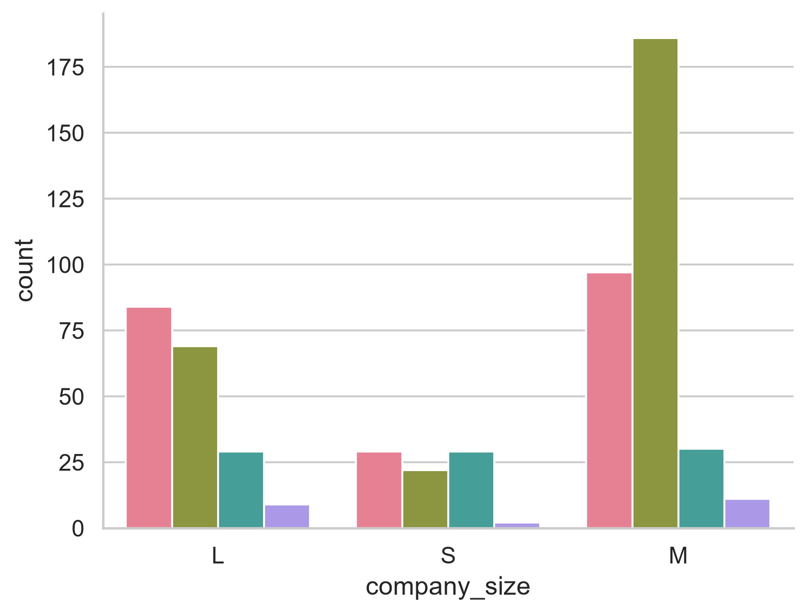
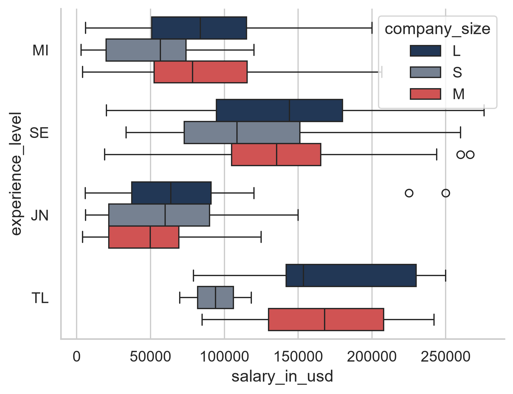
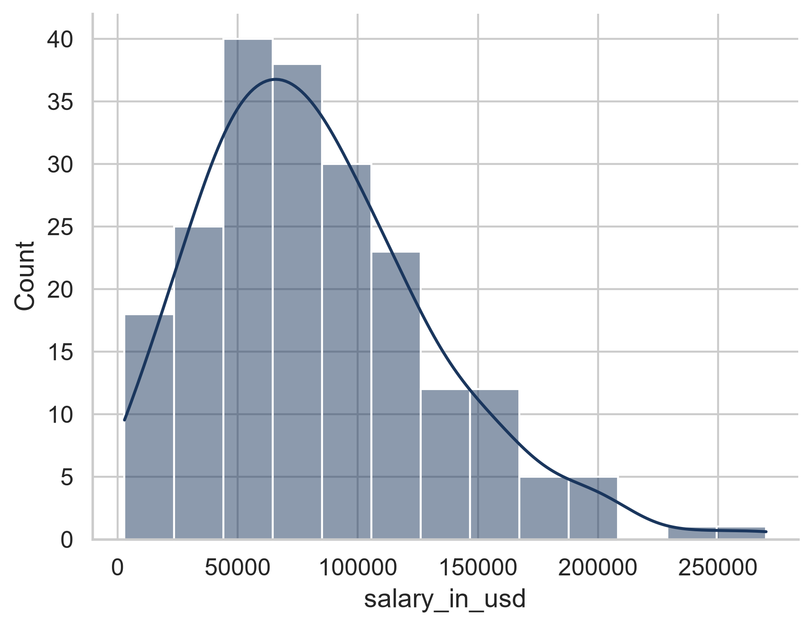
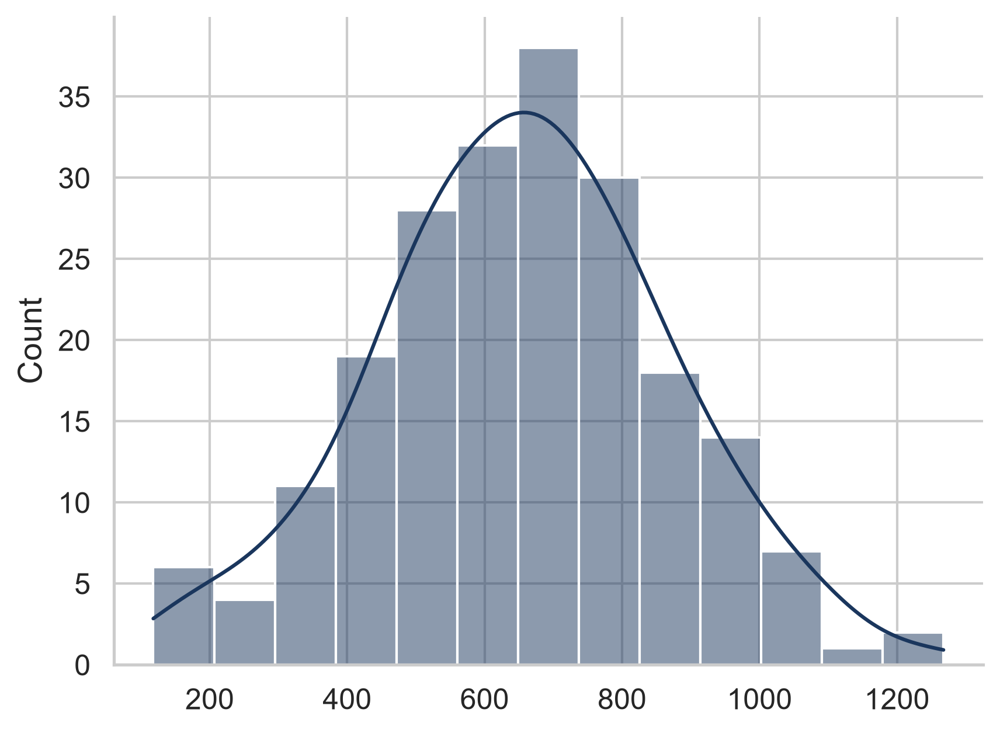
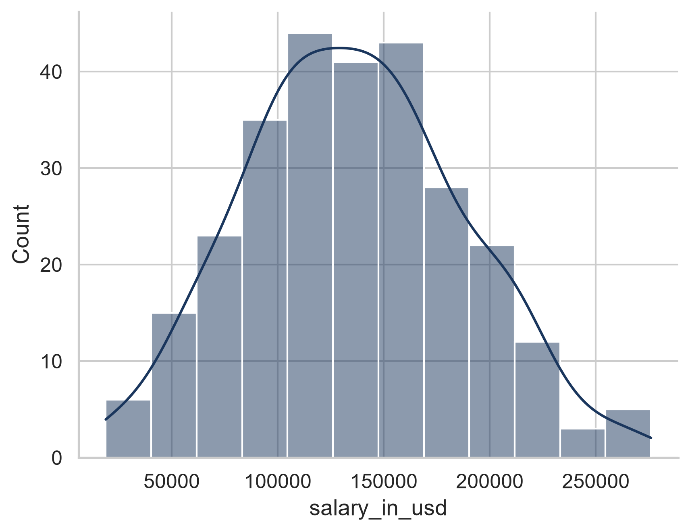
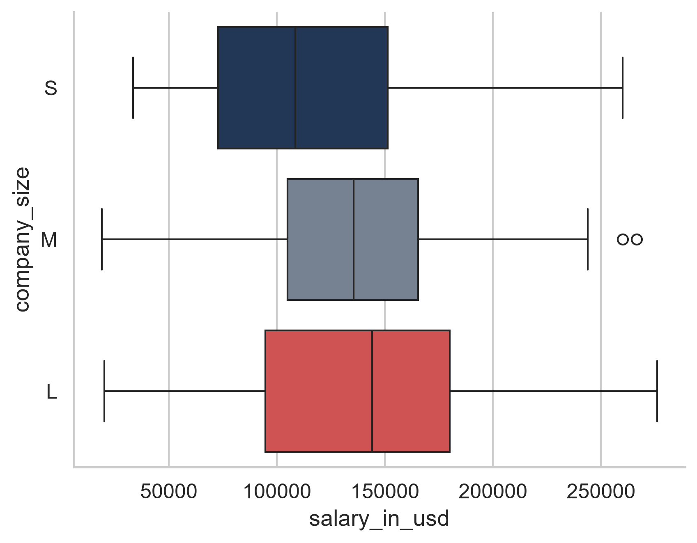
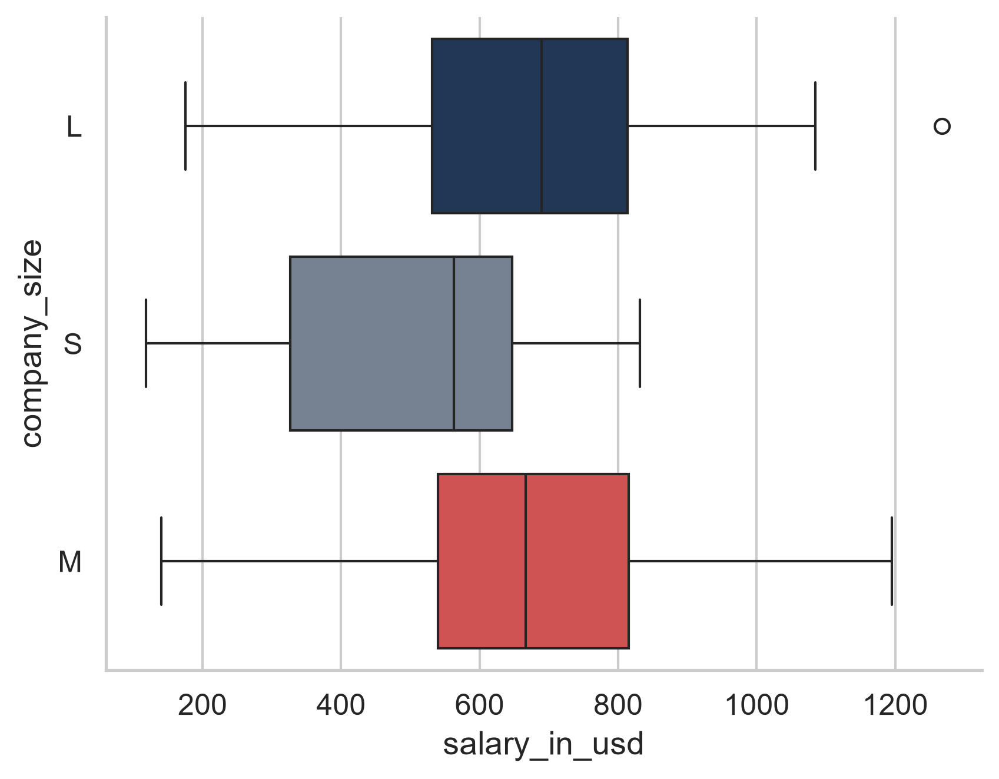

# Job Market Analysis

Проект для анализа рынка труда и вакансий. Находится в разработке.


<details>
<summary>📦 Шаг 1: Окружение и импорт библиотек</summary>

Для выполнения исследования в проекте используются библиотеки `pandas`, `seaborn`, `scipy` и `statsmodels`.

### Код импорта:
```python
# Загрузка, обработка таблиц и подготовка выборок данных
import pandas as pd

# Визуализация данных, построение графиков распределений и боксплотов
import seaborn as sns

# Модуль базовых статистических тестов библиотеки SciPy
from scipy import stats

# Построение линейной модели для ANOVA (дисперсионного анализа)
from statsmodels.formula.api import ols

# Расчет таблицы дисперсионного анализа (ANOVA) по построенной модели
from statsmodels.stats.anova import anova_lm

# Инструменты statsmodels (для построения графиков квантилей QQ-plot)
import statsmodels.api as sm

# Проведение критерия Тьюки (Post-hoc анализ для попарных сравнений)
from statsmodels.stats.multicomp import pairwise_tukeyhsd

# Функции для корреляционного анализа (коэффициенты Пирсона, Спирмена, Кендалла)
from scipy.stats import pearsonr, spearmanr, kendalltau
```

### Установка пакетов:
```bash
pip install pandas seaborn scipy statsmodels
```
</details>


<details>
<summary>❓ Шаг 2: Ключевые вопросы исследования</summary>

В рамках проекта необходимо проанализировать данные и ответить на следующие аналитические вопросы:

1. **Факторы зарплат:** Что сильнее всего влияет на зарплатную вилку вакансий в сфере Data Science?
2. **Распределение грейдов:** Как распределены позиции (грейды) сотрудников в компаниях разного размера? Какие выводы можно сделать на основе этого распределения?
3. **Выбор компании:** В компанию какого размера выгоднее устраиваться кандидатам уровней *Middle* и *Senior*?

---
### 🛠️ Методология анализа
Для поиска обоснованных ответов на эти вопросы в работе последовательно выполняются:
* **Описательный анализ данных** (расчет базовых статистик, мер центральной тенденции и разброса).
* **Корреляционный анализ** (оценка тесноты и направления связей между числовыми признаками).
* **Дисперсионный анализ (ANOVA)** (сравнение средних зарплат и выявление статистически значимых различий между группами факторов).
</details>

<details>
<summary>📊 Шаг 3: Загрузка и предобработка данных</summary>

На этом этапе выполняется загрузка датасета и очистка от технического столбца с индексами с помощью параметра `index_col=0`.

### Код загрузки:
```python
# Читаем файл и сразу убираем первый безымянный столбец с индексами
data = pd.read_csv("datas/ds_salaries.csv", index_col=0)

# Проверяем структуру загруженных данных перед тестами
data.head()
```

### Структура загруженных данных (`data.head()`):

| work_year | experience_level | employment_type | job_title | salary | salary_currency | salary_in_usd | employee_residence | company_location | company_size |
| :---: | :---: | :---: | :--- | :---: | :---: | :---: | :---: | :---: | :---: |
| 2020 | MI | FT | Data Scientist | 70000 | EUR | 79833 | DE | DE | L |
| 2020 | SE | FT | Machine Learning Scientist | 260000 | USD | 260000 | JP | JP | S |
| 2020 | SE | FT | Big Data Engineer | 85000 | GBP | 109024 | GB | GB | M |
| 2020 | MI | FT | Product Data Analyst | 20000 | USD | 20000 | HN | HN | S |
| 2020 | SE | FT | Machine Learning Engineer | 150000 | USD | 150000 | US | US | L |

</details>

<details>
<summary>🔍 Шаг 4: Определение типов признаков (Классификация переменных)</summary>

На этом этапе проводится анализ структуры данных с помощью `data.info()`, проверяются уникальные значения и выполняется классификация каждого признака для корректного подбора статистических критериев (параметрических и непараметрических).

### Код анализа типов данных:
```python
# Получение общей информации о пропусках и типах данных в столбцах
data.info()

# Просмотр уникальных значений для классификации признаков
print("Года:", data['work_year'].unique())
print("Грейды:", data['experience_level'].unique())
print("Размеры компаний:", data['company_size'].unique())
print("Профессии (первые 5):", data['job_title'].unique()[:5])
```

### 📋 Классификация переменных в датасете:

* **Непрерывные переменные (Continuous):**
  * `salary`, `salary_in_usd` — уровень заработной платы (используется для оценки средних значений в ANOVA и корреляционного анализа).

* **Дискретные переменные (Discrete):**
  * `work_year` — год выплаты зарплаты (2020, 2021, 2022 и т.д.).

* **Порядковые переменные (Ordinal):**
  * `experience_level` — уровень квалификации сотрудника (EN, MI, SE, EX), где важен внутренний порядок.
  * `company_size` — масштаб компании (S, M, L), отражающий упорядоченный размер бизнеса.

* **Категориальные / Номинальные переменные (Categorical / Nominal):**
  * `job_title` — наименование вакансии / позиции.
  * `salary_currency` — валюта, в которой выплачивается зарплата (USD, EUR, GBP и др.).
  * `employment_type` — тип занятости (FT, PT и др.).
  * `employee_residence`, `company_location` — географическое положение.

</details>

<details>
<summary>🎨 Шаг 5: Настройка глобального стиля и визуализация данных (EDA)</summary>

На этом этапе задаются единые правила оформления графиков (шрифты, рамки и кастомная палитра) для проведения качественного разведочного анализа.

### Код глобальной настройки стилей:
```python
# Импортируем matplotlib для настройки параметров осей
import matplotlib.pyplot as plt

# Настраиваем минималистичный стиль и крупный читаемый шрифт
sns.set_theme(style="whitegrid", context="notebook", font_scale=1.1)

# Задаем свою стильную палитру (Глубокий синий, Серый, Коралловый акцент)
my_palette = ["#1a365d", "#718096", "#e53e3e"]
sns.set_palette(my_palette)

# Убираем рамки графика сверху и справа для чистоты отображения
plt.rcParams['axes.spines.top'] = False
plt.rcParams['axes.spines.right'] = False
```
</details>

<details>
<summary>📈 Шаг 5: Анализ факторов зарплат (Поиск ответов на Вопрос 1)</summary>

На этом этапе проводится исследование распределения заработных плат, фильтрация аномалий (выбросов), оценка корреляции Спирмена и визуализация плотности распределения в зависимости от грейда и размера компании.

### 1. Первичный анализ и фильтрация выбросов
Для оценки общей структуры целевого признака `salary_in_usd` строится диаграмма размаха («ящик с усами»). На основе графика выявляются экстремальные значения, после чего данные фильтруются (исключаются зарплаты выше \$300,000 для устранения искажений при стат-тестах).

```python
# Визуализация исходного распределения зарплат
sns.boxplot(data=data, x="salary_in_usd")
plt.savefig('images/salary_chart1.png', dpi=300, bbox_inches='tight')
plt.show()

# Фильтрация экстремальных выбросов
data = data[data.salary_in_usd < 300_000]

# Проверка распределения после фильтрации
sns.boxplot(data=data, x="salary_in_usd")
plt.savefig('images/salary_chart2.png', dpi=300, bbox_inches='tight')
plt.show()
```

#### Визуализация распределения до и после фильтрации:
<p align="center">
  
  
</p>

---

### 2. Влияние уровня квалификации (Грейда) на зарплату
Оценивается взаимосвязь между порядковой переменной `experience_level` и непрерывной `salary_in_usd`. С помощью корреляции Спирмена подтверждается статистическая значимость влияния опыта, а график плотности (`histplot` с `kde=True`) наглядно показывает смещение средних зарплат вправо по мере роста грейда.

```python
# Расчет корреляции Спирмена для грейда (требует предварительного кодирования в числа)
spearmanr(data.salary_in_usd, data.experience_level)  # p-value < 0.05

# Визуализация распределения зарплат по грейдам
sns.histplot(data=data, x="salary_in_usd", hue="experience_level", kde=True)
plt.savefig('images/salary_chart3.png', dpi=300, bbox_inches='tight')
plt.show()
```

#### Визуализация распределения зарплат по грейдам:


---

### 3. Влияние размера компании на зарплату
Проводится аналогичный анализ для проверки зависимости зарплаты от масштаба бизнеса (`company_size`). Строится график плотности распределения доходов для компаний типов S, M и L.

```python
# Расчет корреляции Спирмена для размера компании
spearmanr(data.salary_in_usd, data.company_size)

# Визуализация распределения зарплат в зависимости от размера компании
sns.histplot(data=data, x="salary_in_usd", hue="company_size", kde=True)
plt.savefig('images/salary_chart4.png', dpi=300, bbox_inches='tight')
plt.show()
```

#### Визуализация распределения зарплат по размерам компаний:


---

### 4. Анализ структуры выборки (Количество вакансий)
Для понимания сбалансированности данных строятся столбчатые диаграммы (`countplot`), отображающие точное количество представленных в датасете вакансий в разрезе размеров компаний и уровней квалификации сотрудников.

```python
# Количество вакансий по размерам компаний
sns.countplot(data=data, x="company_size", hue="company_size", legend=False)
plt.savefig('images/salary_chart5.png', dpi=300, bbox_inches='tight')
plt.show()

# Количество вакансий по грейдам сотрудников
sns.countplot(data=data, x="experience_level", hue="experience_level", legend=False)
plt.savefig('images/salary_chart6.png', dpi=300, bbox_inches='tight')
plt.show()
```

#### Структура и наполненность выборки:
<p align="center">
  
  
</p>

---

### 🔍 Расширенные аналитические выводы по Вопросу 1:

1. **Сила влияния опыта:** Фактор опыта (`experience_level`) демонстрирует умеренно-сильную положительную корреляцию с уровнем дохода. Различия между подвыборками `JN`, `MI`, `SE`, `TL` выражены ярко: графики плотности распределения последовательно смещаются в сторону более высоких значений. Ошибка $p$-value намного меньше порога $0.05$, что доказывает высокую статистическую значимость фактора.
2. **Влияние масштаба компании:** Фактор размера компании (`company_size`) также вносит вклад в дисперсию зарплат, однако графики распределений имеют бóльшую зону пересечения (особенно между средними M и крупными L компаниями), что потребует проведения детального дисперсионного анализа (ANOVA) для выявления чистых эффектов.
3. **⚠️ Критический дисбаланс выборки по грейдам:** Анализ графика `salary_chart6.png` выявил сильную асимметрию в наполненности групп. В данных наблюдается **огромное преобладание специалистов уровня Senior (`SE`)** и, напротив, **критически малое количество тимлидов (`TL`)**. 
   * *Влияние на анализ:* Такой сильный численный перекос означает, что оценки средних значений и дисперсии для группы `TL` менее стабильны и имеют более широкие доверительные интервалы. Это необходимо учитывать при последующей проверке условий гомогенности дисперсий (тест Левена) перед проведением параметрического ANOVA, так как классический дисперсионный анализ чувствителен к сильному неравенству объемов выборок.

</details>

> 💡 **Ключевой инсайт:** Сильнее всего на зарплатную вилку в Data Science влияет **уровень квалификации (грейд)**, демонстрируя уверенный рост доходов от `JN` к `TL`. Размер компании имеет меньшее значение: пики распределений для средних (`M`) и крупных (`L`) компаний находятся на одном уровне по оси зарплат, что говорит о схожих типичных доходах в этих сегментах. При этом график `M` значительно выше по вертикали из-за дисбаланса в данных (вакансий от средних компаний и специалистов уровня `SE` в выборке подавляющее большинство).

<details>
<summary>👥 Шаг 6: Распределение грейдов в компаниях (Поиск ответов на Вопрос 2)</summary>

На этом этапе исследуется структура найма: как именно распределяются уровни квалификации сотрудников (`experience_level`) внутри компаний различного масштаба (`company_size`), а также оценивается разброс их заработных плат.

### 1. Визуализация структуры найма и распределения доходов
Для анализа численности сотрудников строится групповая столбчатая диаграмма `countplot`. Для детальной оценки плотности и диапазонов зарплат внутри каждого грейда строится классический `boxplot`.

```python
# Визуализация распределения количества грейдов по размерам компаний
sns.countplot(data=data, x="company_size", hue="experience_level")
plt.savefig('images/salary_chart7.png', dpi=300, bbox_inches='tight')
plt.show()

# Анализ распределения зарплат для каждого грейда в разрезе размеров компаний
sns.boxplot(data=data, x="salary_in_usd", y="experience_level", hue='company_size')
plt.savefig('images/salary_chart8.png', dpi=300, bbox_inches='tight')
plt.show()
```

#### Визуализация структуры грейдов и зарплат:
<p align="center">
  
  
</p>

---

### 📋 Выводы на основе распределения:
1. **Компании размера M** значительно чаще нанимают сотрудников грейда `Senior`.
2. **Компании размера L** в процентном соотношении больше нанимают сотрудников грейда `Middle`.
3. **Компании размера L** целенаправленно нанимают специалистов уровня `Middle` и готовы выделять бюджеты и средства, чтобы планомерно развивать их внутри корпорации до уровня `Senior`.
4. **Компании размера M** предпочитают сразу нанимать готовых специалистов грейда `Senior`, чтобы бизнес получал коммерческую пользу и закрывал задачи быстрее, минуя этап долгого обучения.
5. **Компании размера S** нанимают сотрудников всех грейдов относительно равномерно, адаптируясь под текущие небольшие задачи.
6. **Компании всех размеров** крайне редко нанимают сотрудников высшего уровня `TeamLead`. При этом меньше всего тимлидов нанимают именно маленькие компании.

---

</details>

> 💡 **Ключевой инсайт:** Стратегия найма жестко привязана к масштабу бизнеса: средние компании (`M`) делают ставку на скорость и массово привлекают готовых `Senior`-специалистов, в то время как крупные корпорации (`L`) смещают фокус на долгосрочное развитие и нанимают больше `Middle`-инженеров с перспективой внутреннего роста. Позиция `TeamLead` остается штучной и наименее востребованной на рынке для всех типов компаний, а в сегменте `S` найм распределен ровно, без явных приоритетов.

<details>
<summary>🏢 Шаг 7: Выбор масштаба компании для Middle и Senior (Поиск ответов на Вопрос 3)</summary>

На этом этапе проводится глубокое исследование влияния размера компании на уровень дохода отдельно для специалистов уровней Middle (`MI`) и Senior (`SE`) с применением трансформации Бокса-Кокса, проверки гомогенности дисперсий (тест Левена), дисперсионного анализа (ANOVA) и критерия Тьюки.

### 1. Исследование и нормализация данных для грейда Middle
Для устранения асимметрии распределение зарплат мидлов трансформируется с помощью функции `boxcox`, после чего проверяется на графиках плотности.

```python
# Фильтрация данных по грейду Middle и подготовка типа данных для трансформации
middle = data[data.experience_level == "MI"].copy()
middle['salary_in_usd'] = middle['salary_in_usd'].astype('float64')

# Исходное распределение зарплат Middle
sns.histplot(data=middle, x="salary_in_usd", kde=True)
plt.savefig('images/salary_chart9.png', dpi=300, bbox_inches='tight')
plt.show()

# Нормализация данных через Box-Cox трансформацию
tr_data, l = stats.boxcox(middle.salary_in_usd)

# Распределение после трансформации Бокса-Кокса
sns.histplot(tr_data, kde=True)
plt.savefig('images/salary_chart10.png', dpi=300, bbox_inches='tight')
plt.show()

# Запись трансформированных данных обратно в датафрейм
middle.loc[:, ('salary_in_usd')] = tr_data
```

#### Визуализация распределения Middle до и после Box-Cox:
<p align="center">
  
  
</p>

---

### 2. Проверка условий и проведение ANOVA для грейда Middle
Проверяется равенство дисперсий тестом Левена и запускается одномерный дисперсионный анализ для оценки глобальных различий между компаниями `S`, `M` and `L`.

```python
# Оценка объема выборки
middle.shape  # Маленькая выборка

# Разделение зарплат по группам размеров компаний
middle_s = middle[middle.company_size == 'S'].salary_in_usd
middle_m = middle[middle.company_size == 'M'].salary_in_usd
middle_l = middle[middle.company_size == 'L'].salary_in_usd

# Тест Левена на гомогенность дисперсий
stats.levene(middle_s, middle_m, middle_l)  # p-value > 0.05, не можем отклонить H0 о равенстве дисперсий

# Построение линейной модели и расчет таблицы ANOVA
one_way = ols('salary_in_usd ~ company_size', middle).fit()
anova_lm(one_way)  # Отвергаем H0 гипотезу: разница в зарплатах между размерами компаний значима
```

---

### 3. Множественные сравнения (Пост-хок тест Тьюки) для Middle
Так как ANOVA показал наличие значимых различий, запускается попарный критерий Тьюки для точечного выбора лучшей организации.

```python
# Попарные сравнения размеров компаний для грейда Middle
print(pairwise_tukeyhsd(endog=middle.salary_in_usd, alpha=0.05, groups=middle['company_size']))
```
*(Результат теста показывает, что если стоит выбор между организациями, Мидлу лучше выбрать L или M размер).*

---

### 4. Статистический анализ для грейда Senior
Проводится аналогичное исследование влияния размера компаний на доходы более опытных специалистов уровня `SE`.

```python
# Фильтрация данных по грейду Senior
senior = data[data.experience_level == "SE"]

# Визуализация распределения зарплат Senior
sns.histplot(data=senior, x="salary_in_usd", kde=True)
plt.savefig('images/salary_chart11.png', dpi=300, bbox_inches='tight')
plt.show()

# Дисперсионный анализ (ANOVA) для грейда Senior
one_way = ols('salary_in_usd ~ company_size', senior).fit()
anova_lm(one_way)  # p-value > 0.05, нет статистически значимых различий в зарплате между размерами компаний
```

#### Визуализация плотности зарплат Senior:


---

### 5. Финальное сравнение размаха зарплат (Boxplot)
Для итоговой демонстрации результатов строятся сравнительные диаграммы размаха для обеих исследуемых групп.

```python
# Диаграмма размаха зарплат для грейда Senior
sns.boxplot(data=senior, x='salary_in_usd', y='company_size', hue='company_size')
plt.savefig('images/salary_chart12.png', dpi=300, bbox_inches='tight')
plt.show()

# Диаграмма размаха зарплат для грейда Middle
sns.boxplot(data=middle, x='salary_in_usd', y='company_size', hue='company_size')
plt.savefig('images/salary_chart13.png', dpi=300, bbox_inches='tight')
plt.show()
```

#### Итоговые Boxplot графики для Senior и Middle:
<p align="center">
  
  
</p>

---

### 📋 Выводы на основе статистических тестов:
1. **Для Middle-специалистов:** Выявлены математически доказанные различия в доходах. Специалисту грейда `Middle` гораздо выгоднее работать в компании размеров `M` и `L`. Тест Тьюки подтверждает ограничение доходов в компаниях размера `S`.
2. **Для Senior-специалистов:** Значение p-value в ANOVA оказалось больше 0.05. Зарплата `Senior`-специалиста статистически не зависит от размера компании, им не принципиально в какую организацию по масштабу устраиваться.

---


</details>


> 💡 **Ключевой инсайт:** Выбор размера компании критически важен на этапе карьерного роста **`Middle`**, так как средние (`M`) и крупные (`L`) предприятия предлагают значимо бóльшие бюджеты, помогающие преодолеть зарплатный потолок маленьких фирм. При переходе на уровень **`Senior`** зависимость от масштаба бизнеса полностью стирается — высококлассные инженеры получают одинаково высокий доход вне зависимости от того, работают они в стартапе (`S`) или огромной корпорации (`L`).

<details>
<summary>🛠️ <b>Инструкция по развертыванию проекта (Нажмите, чтобы раскрыть)</b></summary>

1. Клонируйте репозиторий.
2. Создайте папку `images` в корне проекта.
3. Установите зависимости:
   ```bash
   pip install pandas seaborn scipy statsmodels
   ```
</details>